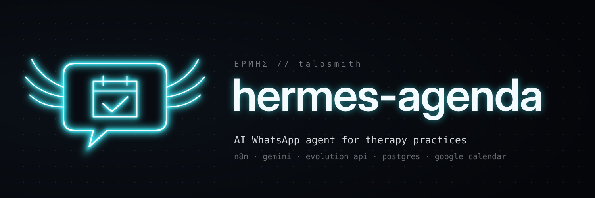
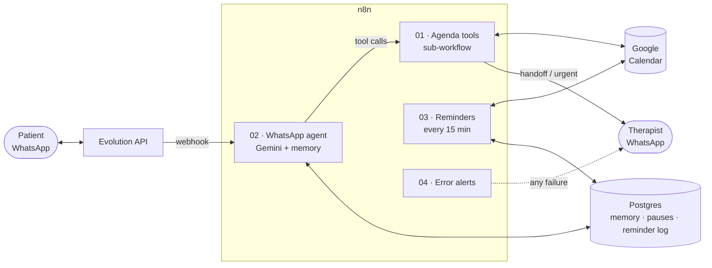

<div align="center">



<p>
  
  
  
  
  
  
</p>

**An AI receptionist on WhatsApp for psychologists.**
It books, lists and cancels sessions, sends reminders and answers FAQs.
When there is any sign of risk, or a topic outside its scope, it hands the conversation to the therapist.

</div>

---

### `> why`

Solo therapists spend hours between sessions answering WhatsApp: *"do you have a slot on Tuesday?"*, *"how much is it?"*, *"can I move tomorrow's session?"*.
hermes-agenda handles that admin work around the clock, and it is built **safety-first**, because the people writing in may be going through a hard time.

> In Greek myth, **Hermes** was the messenger of the gods. Here he carries messages between patients and the therapist's calendar.

### `> features`

| | |
|---|---|
| 📅 **Scheduling** | Finds free slots from a weekly grid plus Google Calendar, books after explicit confirmation, lists and cancels the contact's own sessions. Rescheduling = cancel + book. |
| ⏰ **Reminders** | 24 h reminder (asks for *CONFIRMO*) and 2 h reminder, with quiet hours (no messages 21h–8h). The reminder is also written into the agent's memory, so a reply like "confirmo" has context. |
| 🚨 **Crisis protocol** | Any risk signal → fixed help resources (CVV 188, SAMU 192, 190), immediate `URGENTE` alert to the therapist, bot paused for that contact. |
| 🙋 **Human handoff** | `chamar_psicologa` tool for clinical questions, pricing exceptions, complaints and late cancellations. The bot pauses for 24 h, and the therapist can type `#pausar <number>` / `#voltar <number>` from her own WhatsApp. |
| 🔒 **Privacy by design** | Stores only name, phone and time slots. The agent discourages clinical details in chat, and data is deleted after 90 days. |
| 🛟 **Self-monitoring** | A dedicated error workflow and an AI-failure alert, both rate-limited to one alert per 30 min, so the operator gets one warning instead of hundreds when an API quota runs out. |

### `> architecture`



**The LLM never writes to the calendar directly.** It can only call five tools (`consultar_horarios`, `agendar_sessao`, `meus_agendamentos`, `cancelar_sessao`, `chamar_psicologa`), and the deterministic sub-workflow **01** checks every request:

- the slot must exist in the weekly grid, be at least 12 h ahead and no more than 14 days out;
- a conflict check runs right before the event is created, so two patients can't get the same slot;
- a session can only be cancelled by the phone number that booked it, and only more than 24 h in advance;
- internal event IDs are never shown to patients.

### `> engineering notes`

- **Idempotent reminders:** a `UNIQUE (event_id, tipo, inicio)` constraint plus `ON CONFLICT DO NOTHING … RETURNING` means a reminder is sent exactly once, even with the cron running every 15 min.
- **WhatsApp quirks:** handles LID accounts (the real number comes in `remoteJidAlt` / `senderPn`) and Brazil's optional 9th mobile digit, by matching both variants of the number.
- **Feels human:** replies are delayed 20–30 s to look like a person typing. Audio and images get a polite "please send text" reply instead of a hallucinated answer.
- **Private by default:** n8n and Evolution API talk over the Docker network, and the n8n editor is only reachable through Tailscale. Nothing is open to the internet.

### `> example conversation` <sub>(illustrative)</sub>

```text
👤  Oi, queria marcar uma sessão
🤖  Olá! Sou o assistente virtual do consultório e cuido de informações e agendamentos. (...)
    Você prefere atendimento online ou presencial?
👤  Online, de preferência terça
🤖  Tenho estes horários livres:
    terça, 10/11: 09:00, 14:00 ou 16:00. Qual fica melhor?
👤  14h. Maria Silva
🤖  Posso confirmar *terça, 10/11 às 14:00*, online, em nome de Maria Silva?
👤  Pode
🤖  Prontinho, sessão agendada! Você vai receber um lembrete na véspera. 😊
```

### `> run it`

```bash
git clone https://github.com/talosmith/hermes-agenda && cd hermes-agenda
cp .env.example .env            # fill in passwords and keys
docker compose up -d            # postgres + n8n + evolution api (schema is created automatically)
```

1. **Connect WhatsApp:** create the `consultorio` instance in Evolution API, scan the QR code, and set its webhook to `http://n8n:5678/webhook/whatsapp-psi` (event `MESSAGES_UPSERT`).
2. **Import the workflows** in `workflows/`, in order: 04 → 01 → 02 → 03.
3. **Create the credentials** in n8n: *Google Agenda* (OAuth2), *Google Gemini*, *Postgres Automação*, and *Evolution API* (Header Auth, `apikey: <EVOLUTION_API_KEY>`).
4. **Edit the config nodes** (`Config agenda`, `Config lembretes`, `Config`): calendar ID, weekly grid, therapist's name, the alert number, and the practice details in the agent's system prompt.
5. Activate 04, 01, 02 and 03.

### `> structure`

```
workflows/
  01-agenda-tools.json       deterministic tools the agent can call
  02-whatsapp-agent.json     webhook → normalize → pause check → AI agent → reply
  03-session-reminders.json  24h / 2h reminders + 90-day data retention
  04-error-alerts.json       global error workflow
sql/                         Postgres schema (memory, pauses, reminder log)
docker-compose.yml           reference stack
```

### `> roadmap`

- [ ] Billing: create a charge per session, send a Pix or payment link, and remind about overdue payments
- [ ] Offline evals for the safety prompt (a red-team set of risk messages)
- [ ] Optional backend on the official WhatsApp Cloud API

---

<sub>⚠️ This is an administrative assistant, **not a clinical tool**. It does not provide therapy, triage or medical advice. All data in this repo (names, phone numbers, addresses, CRP) is fictional.</sub>

<sub>🤖 Built with the help of Claude (Anthropic) as an AI pair-programmer for code review, documentation and data sanitization.</sub>

<div align="center"><sub>forged by <a href="https://github.com/talosmith">talosmith</a></sub></div>
